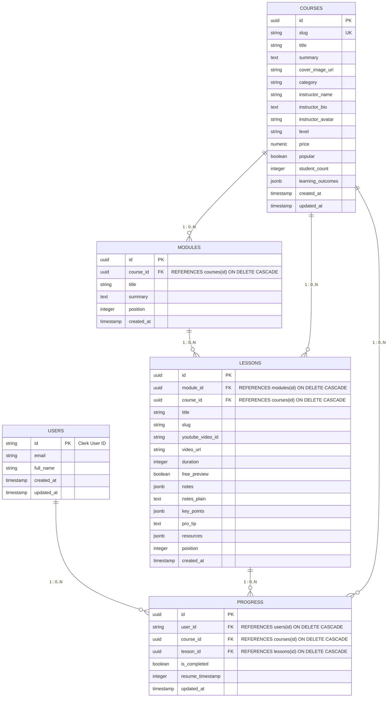

# Vibelearn Backend System Design Specification

- **Date:** 2026-10-17
- **Project:** Vibelearn Backend
- **Branch:** `feat/backend-setup`
- **Target Stack:** NestJS 11 (TypeScript), TypeORM, PostgreSQL (Docker via OrbStack), Clerk Authentication

---

## 1. Overview & Goals

Vibelearn is a learning platform offering structured video courses organized into modules and lessons with YouTube embeds, text notes, and resources. The backend service provides:
1. Public content APIs for course discovery, course details with hierarchical modules/lessons, and lesson streaming metadata.
2. Protected progress-tracking APIs for storing completed lesson states and video playback resumption timestamps.
3. Authenticated user management integrating with Clerk via JWT verification and just-in-time PostgreSQL synchronization.
4. Robust database persistence using PostgreSQL managed through TypeORM with full migrations and an idempotent data seeding pipeline.

---

## 2. Infrastructure & Technology Stack

- **Framework:** NestJS 11 with TypeScript 5.7+
- **Database:** PostgreSQL 16 (running via Docker on OrbStack)
- **Container Port Mapping:** Host port `5433:5432` (avoids conflicts with existing local PostgreSQL instances on port `5432`)
- **ORM:** TypeORM 0.3+ with `@nestjs/typeorm`
- **Authentication:** Clerk via `@clerk/backend`
- **Validation & Transformation:** `class-validator`, `class-transformer`
- **Package Manager:** `pnpm`

---

## 3. Architecture & Directory Structure

The backend follows a strict layered modular architecture:
$$\text{Route / Controller} \longrightarrow \text{Service (Business Logic)} \longrightarrow \text{Repository (TypeORM Queries)} \longrightarrow \text{Database}$$

> **CLI Generation Requirement:** In every feature module, developers and agents MUST use the NestJS CLI resource generator (`pnpm exec nest g resource modules/<name>`) to scaffold initial boilerplate (module, controller, service, entity, dto) before applying custom repository and business logic.

Each functional domain is encapsulated into a separate NestJS module:

```text
vibelearn-backend/
├── docker-compose.yml              # Local PostgreSQL container (port 5433:5432)
├── .env.example                    # Environment variables template
├── docs/
│   └── superpowers/specs/          # Architectural design and implementation specifications
├── src/
│   ├── database/                   # Database connection, TypeORM datasource & seeds
│   │   ├── database.module.ts
│   │   ├── data-source.ts          # TypeORM CLI DataSource configuration
│   │   ├── migrations/             # TypeORM generated migration files
│   │   └── seeds/
│   │       └── seed.ts             # Idempotent seed script (seed.ndjson & videos.json)
│   ├── common/                     # Cross-cutting utilities
│   │   ├── filters/
│   │   │   └── http-exception.filter.ts  # Standardized error response format
│   │   ├── decorators/
│   │   │   └── current-user.decorator.ts # Injects authenticated User entity
│   │   └── pipes/                  # Custom validation pipes
│   ├── modules/
│   │   ├── auth/                   # Clerk JWT validation & guards
│   │   │   ├── auth.module.ts
│   │   │   ├── clerk.service.ts
│   │   │   └── guards/
│   │   │       └── clerk-auth.guard.ts
│   │   ├── users/                  # User management & synchronization
│   │   │   ├── users.module.ts
│   │   │   ├── users.controller.ts
│   │   │   ├── users.service.ts
│   │   │   ├── users.repository.ts
│   │   │   └── entities/user.entity.ts
│   │   ├── courses/                # Course catalog & administration
│   │   │   ├── courses.module.ts
│   │   │   ├── courses.controller.ts
│   │   │   ├── courses.service.ts
│   │   │   ├── courses.repository.ts
│   │   │   ├── entities/course.entity.ts
│   │   │   └── dto/
│   │   │       ├── create-course.dto.ts
│   │   │       ├── update-course.dto.ts
│   │   │       └── query-courses.dto.ts
│   │   ├── modules/                # Course modules grouping
│   │   │   ├── course-modules.module.ts
│   │   │   ├── course-modules.service.ts
│   │   │   ├── course-modules.repository.ts
│   │   │   └── entities/module.entity.ts
│   │   ├── lessons/                # Lesson content, notes, resources
│   │   │   ├── lessons.module.ts
│   │   │   ├── lessons.controller.ts
│   │   │   ├── lessons.service.ts
│   │   │   ├── lessons.repository.ts
│   │   │   └── entities/lesson.entity.ts
│   │   └── progress/               # Progress tracking & video resume
│   │       ├── progress.module.ts
│   │       ├── progress.controller.ts
│   │       ├── progress.service.ts
│   │       ├── progress.repository.ts
│   │       ├── entities/progress.entity.ts
│   │       └── dto/
│   │           └── upsert-progress.dto.ts
│   ├── app.module.ts               # Root application module
│   └── main.ts                     # Bootstrap, validation pipe & global prefix (/api)
```

---

## 4. Database Schema & Cardinality Specifications



### Table Definitions & Constraints

1. **`users`**
   - `id`: `VARCHAR` (Primary Key, matching Clerk User ID, e.g. `user_2...`).
   - `email`: `VARCHAR`, nullable.
   - `full_name`: `VARCHAR`, nullable.
   - `created_at`: `TIMESTAMPTZ`, default `NOW()`.
   - `updated_at`: `TIMESTAMPTZ`, default `NOW()`.

2. **`courses`**
   - `id`: `UUID` (Primary Key, default `gen_random_uuid()`).
   - `slug`: `VARCHAR` (Unique, indexed).
   - `title`: `VARCHAR` (Not Null).
   - `summary`: `TEXT`, nullable.
   - `cover_image_url`: `VARCHAR`, nullable.
   - `category`: `VARCHAR`, nullable.
   - `instructor_name`: `VARCHAR`, nullable.
   - `instructor_bio`: `TEXT`, nullable.
   - `instructor_avatar`: `VARCHAR`, nullable.
   - `level`: `VARCHAR`, nullable (`Beginner`, `Intermediate`, `Advanced`).
   - `price`: `NUMERIC(10, 2)`, default `0.00`.
   - `popular`: `BOOLEAN`, default `false`.
   - `student_count`: `INTEGER`, default `0`.
   - `learning_outcomes`: `JSONB`, nullable.
   - `created_at`: `TIMESTAMPTZ`, default `NOW()`.
   - `updated_at`: `TIMESTAMPTZ`, default `NOW()`.

3. **`modules`**
   - `id`: `UUID` (Primary Key, default `gen_random_uuid()`).
   - `course_id`: `UUID` (Foreign Key $\rightarrow$ `courses.id`, `ON DELETE CASCADE`).
   - `title`: `VARCHAR` (Not Null).
   - `summary`: `TEXT`, nullable.
   - `position`: `INTEGER` (Not Null, 1-indexed ordering).
   - `created_at`: `TIMESTAMPTZ`, default `NOW()`.
   - **Index:** `idx_modules_course_position` on `(course_id, position)`.

4. **`lessons`**
   - `id`: `UUID` (Primary Key, default `gen_random_uuid()`).
   - `module_id`: `UUID` (Foreign Key $\rightarrow$ `modules.id`, `ON DELETE CASCADE`).
   - `course_id`: `UUID` (Foreign Key $\rightarrow$ `courses.id`, `ON DELETE CASCADE`).
   - `title`: `VARCHAR` (Not Null).
   - `slug`: `VARCHAR` (Not Null).
   - `youtube_video_id`: `VARCHAR` (Not Null).
   - `video_url`: `VARCHAR`, nullable.
   - `duration`: `INTEGER`, default `0` (duration in seconds).
   - `free_preview`: `BOOLEAN`, default `false`.
   - `notes`: `JSONB`, nullable.
   - `notes_plain`: `TEXT`, nullable.
   - `key_points`: `JSONB`, nullable.
   - `pro_tip`: `TEXT`, nullable.
   - `resources`: `JSONB`, nullable.
   - `position`: `INTEGER` (Not Null, 1-indexed ordering within module).
   - `created_at`: `TIMESTAMPTZ`, default `NOW()`.
   - **Indexes:**
     - `idx_lessons_course_slug` on `(course_id, slug)`.
     - `idx_lessons_module_position` on `(module_id, position)`.

5. **`progress`**
   - `id`: `UUID` (Primary Key, default `gen_random_uuid()`).
   - `user_id`: `VARCHAR` (Foreign Key $\rightarrow$ `users.id`, `ON DELETE CASCADE`).
   - `course_id`: `UUID` (Foreign Key $\rightarrow$ `courses.id`, `ON DELETE CASCADE`).
   - `lesson_id`: `UUID` (Foreign Key $\rightarrow$ `lessons.id`, `ON DELETE CASCADE`).
   - `is_completed`: `BOOLEAN`, default `false`.
   - `resume_timestamp`: `INTEGER`, default `0` (seconds).
   - `updated_at`: `TIMESTAMPTZ`, default `NOW()`.
   - **Unique Index:** `idx_progress_user_lesson` on `(user_id, lesson_id)` (ensures atomic upserts).
   - **Index:** `idx_progress_user_course` on `(user_id, course_id)`.

---

## 5. API Specification & HTTP Status Codes

Global API prefix: `/api`.

### Course Endpoints

#### 1. List Courses
- **Path:** `GET /api/courses`
- **Auth:** Public
- **Query Params:** `category?: string`, `search?: string`
- **Status Codes:**
  - `200 OK`: Array of course summary objects.

#### 2. Get Course by Slug
- **Path:** `GET /api/courses/:slug`
- **Auth:** Public
- **Status Codes:**
  - `200 OK`: Full course object with nested `modules` and `lessons` ordered by `position`.
  - `404 Not Found`: If no course matches the slug.

#### 3. Create Course
- **Path:** `POST /api/courses`
- **Auth:** Protected (`ClerkAuthGuard`)
- **Body:** `CreateCourseDto`
- **Status Codes:**
  - `201 Created`: Created course entity.
  - `400 Bad Request`: Validation failure.
  - `401 Unauthorized`: Missing or invalid Bearer token.
  - `409 Conflict`: Slug already exists.

#### 4. Update Course
- **Path:** `PUT /api/courses/:id`
- **Auth:** Protected (`ClerkAuthGuard`)
- **Body:** `UpdateCourseDto`
- **Status Codes:**
  - `200 OK`: Updated course entity.
  - `400 Bad Request`: Invalid ID or body.
  - `401 Unauthorized`: Missing or invalid Bearer token.
  - `404 Not Found`: Course not found.

#### 5. Delete Course
- **Path:** `DELETE /api/courses/:id`
- **Auth:** Protected (`ClerkAuthGuard`)
- **Status Codes:**
  - `204 No Content`: Successful cascading deletion.
  - `401 Unauthorized`: Missing or invalid Bearer token.
  - `404 Not Found`: Course not found.

---

### Lesson Endpoints

#### 1. Get Lesson by Course & Lesson Slug
- **Path:** `GET /api/courses/:courseSlug/lessons/:lessonSlug`
- **Auth:** Public
- **Status Codes:**
  - `200 OK`: Full lesson details, notes, resources, along with previous/next lesson slugs.
  - `404 Not Found`: Course or lesson not found.

#### 2. Get Lesson by ID
- **Path:** `GET /api/lessons/:id`
- **Auth:** Public
- **Status Codes:**
  - `200 OK`: Lesson detail entity.
  - `404 Not Found`: Lesson not found.

---

### Progress Endpoints

#### 1. Get User Progress
- **Path:** `GET /api/progress`
- **Auth:** Protected (`ClerkAuthGuard`)
- **Query Params:** `courseId?: string`
- **Status Codes:**
  - `200 OK`: Array of progress records for authenticated user.
  - `401 Unauthorized`: Missing or invalid Bearer token.

#### 2. Upsert Progress Record
- **Path:** `POST /api/progress`
- **Auth:** Protected (`ClerkAuthGuard`)
- **Body:**
  ```json
  {
    "courseId": "3fa85f64-5717-4562-b3fc-2c963f66afa6",
    "lessonId": "3fa85f64-5717-4562-b3fc-2c963f66afa6",
    "isCompleted": true,
    "resumeTimestamp": 185
  }
  ```
- **Status Codes:**
  - `200 OK`: Upserted progress state.
  - `400 Bad Request`: Validation failure.
  - `401 Unauthorized`: Missing or invalid Bearer token.
  - `404 Not Found`: Referenced course or lesson does not exist.

#### 3. Toggle Lesson Completion
- **Path:** `PATCH /api/progress/complete`
- **Auth:** Protected (`ClerkAuthGuard`)
- **Body:** `{ "courseId": "...", "lessonId": "...", "isCompleted": true }`
- **Status Codes:**
  - `200 OK`: Updated progress state.
  - `401 Unauthorized`: Missing or invalid Bearer token.

---

### User Endpoints

#### 1. Get Current User Profile
- **Path:** `GET /api/users/me`
- **Auth:** Protected (`ClerkAuthGuard`)
- **Status Codes:**
  - `200 OK`: Current user profile with aggregated completed lessons and active courses.
  - `401 Unauthorized`: Missing or invalid Bearer token.

#### 2. Synchronize User Record
- **Path:** `POST /api/users/sync`
- **Auth:** Protected (`ClerkAuthGuard`)
- **Body:** `{ "email"?: string, "fullName"?: string }`
- **Status Codes:**
  - `200 OK`: Existing user updated.
  - `201 Created`: New user registered in PostgreSQL.
  - `401 Unauthorized`: Missing or invalid Bearer token.

---

## 6. Authentication Architecture (`AuthModule`)

Authentication relies on Clerk's cryptographically signed session JWT:
1. Client signs in through Clerk UI components on the frontend and receives a session JWT.
2. Every protected API request carries `Authorization: Bearer <clerk_token>`.
3. `ClerkAuthGuard` intercepts the request:
   - Validates the token signature using `@clerk/backend` (`clerkClient.verifyToken()`).
   - Extracts the Clerk User ID from the JWT payload (`sub`).
   - Performs Just-In-Time (JIT) lookup in PostgreSQL `users`. If missing, fetches user profile via `clerkClient.users.getUser(userId)` and creates the database user record.
   - Injects the resolved user entity into `request.user`.
4. Custom decorator `@CurrentUser()` provides clean, typed access in controllers:
   ```typescript
   @Get('me')
   getMe(@CurrentUser() user: User) {
     return user;
   }
   ```

---

## 7. Data Seeding Pipeline (`pnpm run db:seed`)

- **Source Files:**
  - `/Users/lyyeakkhai/workspace/vibe-learn/docs/seed.ndjson`
  - `/Users/lyyeakkhai/workspace/vibe-learn/docs/videos.json`
- **Execution:** A standalone executable script `src/database/seeds/seed.ts` executed with `ts-node` or `pnpm run db:seed`.
- **Parsing Logic:**
  1. Parse NDJSON documents: Categories, Courses, Modules, Lessons.
  2. Resolve Sanity reference links (e.g. `_ref: "lesson.nextjs-app-router-in-depth-server-components"`).
  3. Map video metadata from `videos.json` (duration, YouTube IDs, queries).
  4. Perform atomic idempotent upsert into `courses`, `modules`, and `lessons` tables.

---

## 8. Error Handling & Validation

1. **ValidationPipe:** Configured globally in `main.ts` with `whitelist: true`, `forbidNonWhitelisted: true`, and `transform: true`.
2. **HttpExceptionFilter:** Standardizes all error payloads:
   ```json
   {
     "statusCode": 404,
     "error": "Not Found",
     "message": "Course with slug 'nextjs-mastery' was not found",
     "timestamp": "2026-10-17T03:55:00.000Z",
     "path": "/api/courses/nextjs-mastery"
   }
   ```

---

## 9. Testing & Quality Assurance Plan

1. **Unit Tests:** Jest specs for each Service and Controller mocking TypeORM repositories.
2. **E2E Integration Tests:** Supertest validating:
   - Public courses listing (`200 OK`).
   - Detailed course retrieval with module/lesson relations (`200 OK`).
   - 401 response when accessing `/api/progress` without Bearer token.
   - Validation failure with `400 Bad Request` on malformed inputs.
